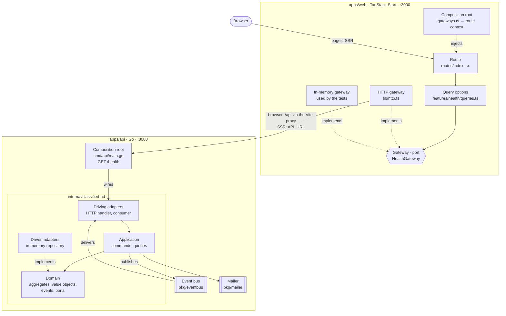

# DDD Second-Hand Marketplace

A pedagogical **second-hand marketplace** built with **Domain-Driven Design** and **hexagonal architecture**: a Go API and a TanStack Start frontend, with the agent harness (skills, glossaries, checks) to build features on top.

This is the starting point: the API answers `/health`, the frontend shows whether it can reach it, and no business feature exists yet.

## Prerequisites

- **Go 1.25.3** or higher — <https://go.dev/dl/>
- **Node.js 24** with **pnpm** — after installing Node, run `corepack enable`
- **make** (on Windows, use WSL)
- **Docker** — optional, only for `make up`

## Getting started

```bash
make install
make dev
```

Open <http://localhost:3000>: the home page says **API reachable**. The API itself listens on <http://localhost:8080>:

```bash
curl http://localhost:8080/health
# {"status":"ok"}
```

To run both in containers instead: `make up`.

## Commands

| Command        | What it does                                                        |
| -------------- | ------------------------------------------------------------------- |
| `make dev`     | API on :8080 and frontend on :3000                                  |
| `make test`    | Tests of both apps                                                  |
| `make lint`    | Format, lint and type checks of both apps                           |
| `make build`   | API binary and frontend build                                       |
| `make check`   | Everything CI runs: docs budget, lint, tests, builds                |
| `make up`      | Both apps in Docker Compose                                         |
| `make help`    | Every target                                                        |

## Layout

```
apps/api/         Go API: one bounded context per folder under internal/
apps/web/         TanStack Start frontend: one folder per feature under src/features/
documentation/    glossary/ (domain + technical), specs/, tickets/
prompts/          prompts worth keeping
tools/            docs-budget: size check of the agent docs
.claude/          skills, agents and hooks for Claude Code
```

## Architecture



Solid arrows are calls, dotted arrows are an adapter implementing a port. Both apps follow the same dependency rule: **adapters → application → domain**, never the reverse. In the API the domain declares ports that adapters implement; in the frontend pages depend on gateways, implemented over HTTP in the app and in memory in the tests.

Today only `/health` exists, answered directly in `main.go`; the `classified-ad` bounded context is an empty skeleton. Each new bounded context is another hexagon beside it, and two bounded contexts talk only through the event bus.

## Working with the agent

`AGENTS.md` is the entry point for coding agents; `CLAUDE.md` loads it together with the two glossaries. The usual path for a feature:

1. `/grill-with-docs` — challenge the idea and settle its vocabulary in the domain glossary
2. `/to-spec` — write the spec to `documentation/specs/`
3. `/to-tickets` — split it into vertical slices under `documentation/tickets/`
4. implement with the `tactical-ddd` (API) and `frontend-development` (frontend) skills
5. `make check`, then the `docs-scribe` agent to update the glossaries and the module docs

The skills `grilling`, `grill-me`, `grill-with-docs`, `domain-modeling`, `codebase-design`, `to-spec`, `to-tickets`, `to-questionnaire` and `handoff` come from [mattpocock/skills](https://github.com/mattpocock/skills) (MIT, see `.claude/skills/LICENSE-mattpocock-skills.txt`); `to-spec` and `to-tickets` are adapted to write files instead of tracker issues.
